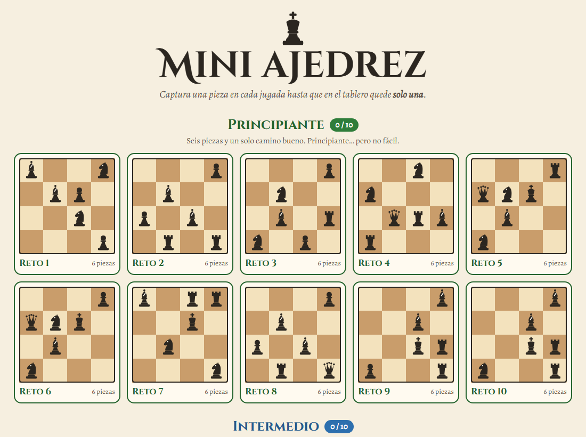

# Mini ajedrez

Retos de ajedrez en un tablero de 4×4: **captura una pieza en cada jugada hasta que en el tablero quede solo una.**
Cuarenta retos en cuatro niveles, todos con **una sola solución**. Juego web autónomo en un único `index.html`.

**Jugar:** https://spyder-cripto.github.io/mini-ajedrez/

## Cómo se juega
- **Todas las jugadas son capturas:** una pieza se mueve como en el ajedrez y se come a otra. No se puede mover a una casilla vacía.
- Todas las piezas son del mismo equipo: cualquiera puede comerse a cualquiera… **menos al rey**, al que nunca se captura.
- Solo el caballo salta por encima de otras piezas. El peón captura una casilla en diagonal **hacia arriba** y no se corona.
- Ganas cuando queda **una sola pieza**.
- Toca una pieza y luego la que quieres capturar, o arrástrala encima. Hay deshacer, reiniciar, comprobar (¿todavía se
  puede ganar desde aquí?) y pistas en dos pasos. El progreso se guarda en el navegador.

## Los retos
Creados por ordenador y elegidos por su dificultad **para una persona que razona**, no solo por lo difícil que es acertar
al azar: se mide cuántas posiciones tendría que mirar alguien que aplica las deducciones habituales (casillas que se
quedan vacías para siempre, piezas a las que nadie puede llegar…). Además, en cada solución capturan varias piezas
distintas y, en los niveles altos, el rey empieza rodeado.

| Nivel | Piezas |
|---|---|
| Principiante | 6 |
| Intermedio | 7 |
| Avanzado | 8 |
| Experto | 9 |

Basado en el clásico «solitario de ajedrez». Los retos son propios.
